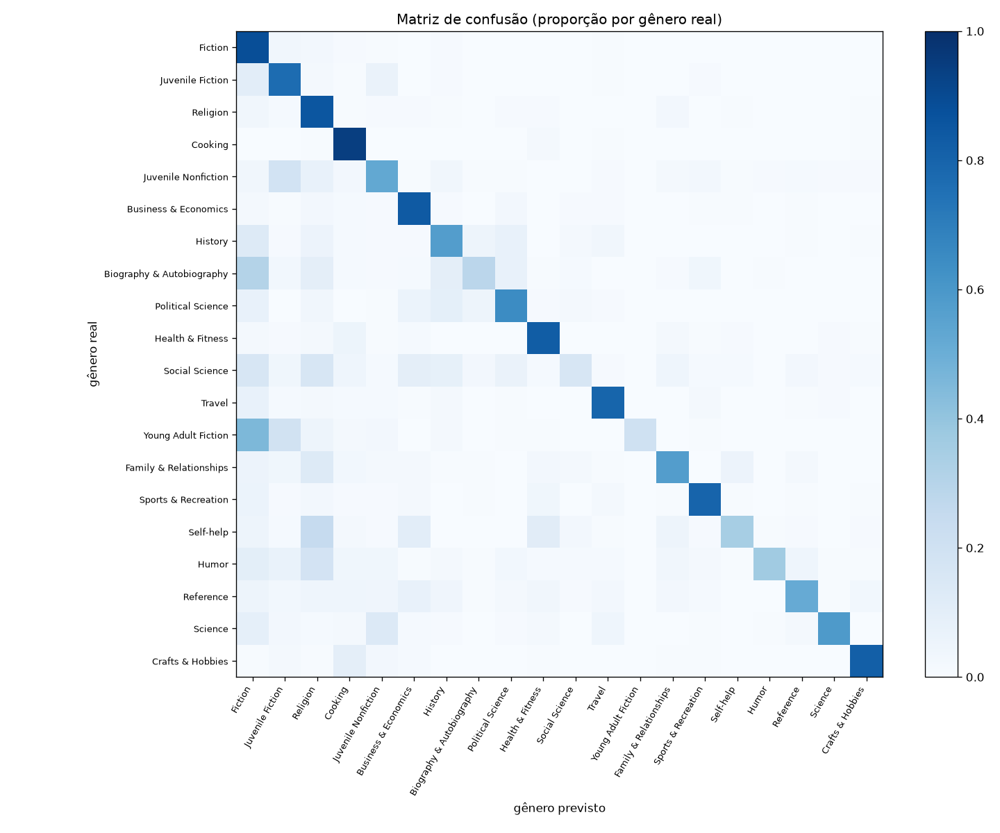
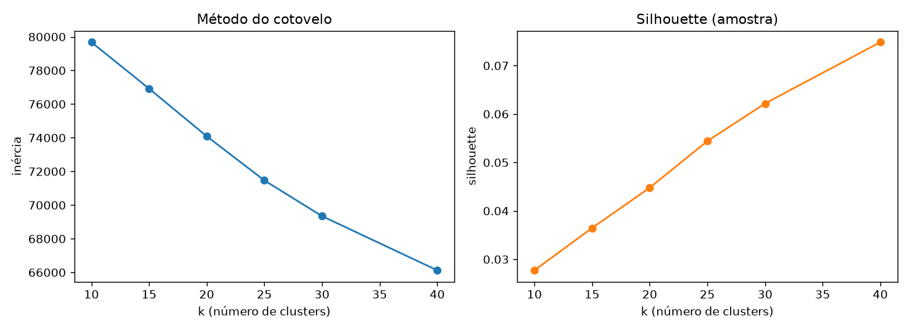

# Mineração de Dados no NextRead — processo CRISP-DM

Este documento mostra como o NextRead aplica as fases do **CRISP-DM** ao catálogo de livros, com
um modelo **supervisionado** (classificação de gênero) e um **não supervisionado** (clusterização).
Os números vêm de uma execução real sobre o banco `livros_pi`, em 14/11/2026:

```bash
cd ml
python -m Scripts.ExecutarMineracao
```

O comando leva cerca de 2 minutos, imprime as métricas e salva os relatórios em
`ml/artefatos/` (`avaliacao-classificacao.json`, `avaliacao-clusterizacao.json` e as figuras).
Todas as etapas usam semente fixa (`random_state = 42`). Nenhuma tabela é alterada.

## 1. Entendimento do negócio

O NextRead recomenda livros parecidos com o que a pessoa está vendo. A recomendação é por
conteúdo (TF-IDF + cosseno sobre título, categoria, autores e descrição) e depende muito da
**categoria**. Só que 25.634 dos 99.310 livros (25,8%) não têm categoria.

Daí saem duas perguntas de mineração:

- **Supervisionada:** dá para prever o gênero de um livro só pelo título, pelos autores e pela
  descrição? Se der, o classificador pode completar as categorias que faltam (modo `--hibrido`
  do recomendador).
- **Não supervisionada:** sem dizer quais são os gêneros, os livros se agrupam sozinhos por
  assunto? Os grupos que aparecem lembram os gêneros que o mercado usa?

Critério de sucesso: superar com folga a referência ingênua (chutar sempre o gênero mais comum)
e conseguir explicar os grupos encontrados.

## 2. Entendimento dos dados

- Origem: `BooksDataset.csv` (Kaggle), carregado na tabela `livros` pela ingestão em `ml/`.
- 99.310 livros; 73.676 com categoria; 67.016 com descrição.
- A categoria é hierárquica, separada por vírgula (`Fiction, Mystery & Detective, General`).
  Há 3.096 combinações diferentes, mas só 58 valores no **primeiro nível**.
- O "lixo" de categorias (`DE`, `MD`, `WV)`) aparece só nos subníveis, por exemplo
  `Travel, United States, South, South Atlantic (DC, DE, FL, …)`. O primeiro nível é limpo.
- As classes são desbalanceadas: `Fiction` sozinho tem 17.379 livros (23,6% dos categorizados);
  o 20º gênero (`Crafts & Hobbies`) tem 1.001.

## 3. Preparação dos dados

- **Rótulo (alvo):** primeiro nível da categoria (`CategoriaPrincipal`). Ficaram os 20 gêneros
  mais frequentes (mínimo de 30 livros cada), cobrindo 59.804 livros.
- **Atributos:** título (peso 2), autores e descrição (`MontarTextoDeClassificacao`).
  A categoria **nunca** entra no texto, nem no classificador nem na clusterização. Se entrasse,
  o modelo veria a resposta dentro da pergunta (vazamento).
- **Vetorização:** TF-IDF com acentos removidos, stop words em inglês, `sublinear_tf`,
  `min_df = 2`, `max_df = 0,95`, até 40.000 termos.
- **Divisão:** holdout estratificado 80/20 (47.843 treino / 11.961 teste). O vocabulário e a
  seleção de atributos são ajustados **só no treino**.
- **Clusterização:** usa os 99.310 livros com algum texto, inclusive os sem categoria. O TF-IDF
  é reduzido com TruncatedSVD (100 componentes) e normalizado (L2), para o KMeans trabalhar
  com distância parecida com a do cosseno.

## 4. Modelagem

**Supervisionado:** cinco modelos treinados e medidos no mesmo conjunto de teste:

| Modelo | Papel |
|---|---|
| Classe majoritária (`DummyClassifier`) | referência mínima: sempre chuta `Fiction` |
| Multinomial Naive Bayes | modelo probabilístico clássico para texto |
| Naive Bayes + `SelectKBest(chi²)` (10.000 termos) | seleção de atributos supervisionada |
| KNN + χ², configuração padrão (k = 5, distância euclidiana) | primeira tentativa com KNN, mantida para comparar |
| **KNN com distância de cosseno** (k = 25, voto ponderado pela similaridade) | o mesmo KNN, com a medida de distância adequada para texto |

O melhor modelo pelo F1 macro vira o artefato `modelo-categorias.joblib`, retreinado com todos
os livros rotulados depois da avaliação.

**Por que o cosseno no KNN.** O KNN classifica um livro pelo gênero dos k livros mais próximos,
então tudo depende de como "proximidade" é medida. A distância euclidiana mede a linha reta
entre dois vetores e é sensível ao tamanho deles. Depois do χ², livros com poucas palavras
selecionadas viram vetores curtos, perto da origem, e ficam "próximos" uns dos outros só por isso.
O cosseno mede o ângulo entre os vetores, ou seja, se os textos falam dos mesmos assuntos,
independente do tamanho. É a mesma medida que o recomendador do NextRead já usa para achar
livros parecidos.

**Não supervisionado:** `MiniBatchKMeans`. O k foi avaliado em 10, 15, 20, 25, 30 e 40 pelo
**método do cotovelo** (inércia) e pelo **silhouette** (amostra fixa de 10 mil livros).
O modelo final usa **k = 20**, o mesmo número de gêneros do classificador, para poder comparar.

## 5. Avaliação

### Classificação de gênero (teste com 11.961 livros)

| Modelo | Acurácia | F1 macro | F1 ponderado |
|---|---:|---:|---:|
| Classe majoritária | 0,291 | 0,023 | 0,131 |
| Naive Bayes | 0,591 | 0,371 | 0,522 |
| Naive Bayes + χ² | 0,642 | 0,466 | 0,589 |
| KNN + χ² (k = 5, euclidiana) | 0,378 | 0,173 | 0,290 |
| **KNN cosseno (k = 25, ponderado)** | **0,728** | **0,629** | **0,710** |

- O KNN com cosseno acerta o gênero de quase 3 em cada 4 livros. Isso é 2,5 vezes a referência,
  num problema com 20 classes.
- O F1 macro (média simples entre os gêneros) é a métrica principal, porque não deixa o
  `Fiction`, que é muito grande, esconder os gêneros pequenos.
- **O mesmo algoritmo vai de 0,173 para 0,629 de F1 macro só trocando a medida de distância.**
  A configuração padrão (euclidiana sobre os atributos do χ²) quase não aprende nada, enquanto o
  cosseno supera todos os outros modelos. No pré-processamento de texto, a escolha da distância
  pesa tanto quanto a escolha do algoritmo.
- A seleção χ² ajuda o Naive Bayes (+0,095 de F1 macro), mas atrapalha o KNN euclidiano, porque
  desequilibra o tamanho dos vetores (21 livros do teste ficam sem nenhum termo selecionado).
- Gêneros mais fáceis: `Cooking` (F1 0,864), `Fiction` (0,844), `Business & Economics` (0,799).
  Mais difíceis: `Social Science` (0,245), `Young Adult Fiction` (0,327),
  `Biography & Autobiography` (0,385). São gêneros "guarda-chuva" ou que dividem vocabulário com
  a ficção.
- As confusões mais comuns fazem sentido: `Juvenile Fiction` → `Fiction` (138 livros),
  `Young Adult Fiction` → `Fiction` (137), `Biography & Autobiography` → `Fiction` (129) e
  `Juvenile Nonfiction` → `Juvenile Fiction` (115). O texto fala do mesmo assunto, e o que muda
  é o público.

**Por que o KNN com cosseno foi o escolhido para o NextRead:**
1. **Melhor resultado entre os algoritmos estudados** (Naive Bayes e KNN), com o maior F1 macro e
   a maior acurácia.
2. **Explicável:** dá para mostrar *por que* um livro recebeu um gênero. Basta listar os 25
   livros mais parecidos e os gêneros deles.
3. **Coerente com o produto:** o recomendador e a futura lista "Para você" usam a mesma ideia
   (vizinhos mais próximos por cosseno sobre TF-IDF). É uma técnica só, reaproveitada em três lugares.
4. **Dá probabilidade:** a proporção ponderada dos votos funciona como confiança, e é o que o modo
   `--hibrido` usa para só completar categorias quando tem certeza (≥ 0,75).

Também testamos, fora do conteúdo da disciplina, uma regressão logística balanceada. Ela chegou a
0,686 de F1 macro, um pouco acima do KNN, mas ficou de fora porque não dá a explicação por
vizinhos e não reaproveita a mesma técnica do recomendador.



### Clusterização (99.310 livros)

| k | Inércia | Silhouette |
|---:|---:|---:|
| 10 | 79.678 | 0,028 |
| 15 | 76.920 | 0,036 |
| **20** | **74.092** | **0,045** |
| 25 | 71.466 | 0,054 |
| 30 | 69.345 | 0,062 |
| 40 | 66.123 | 0,075 |



- **Sem cotovelo nítido e silhouette baixo:** a inércia cai de forma quase linear, e o silhouette
  sobe devagar com k, sempre perto de zero. Isso é comum em texto: os livros não formam grupos
  bem separados, os assuntos se misturam. Por isso o k foi escolhido pela interpretação (20,
  como os gêneros) e não por um "ótimo" que os dados não mostram.
- **Validação externa** contra os gêneros (73.676 livros com categoria): pureza 0,392,
  ARI 0,162, NMI 0,257. Os grupos têm relação com os gêneros, mas não são cópia deles.

Alguns grupos que o KMeans encontrou **sem saber os gêneros** (termos mais fortes do centróide):

| Grupo | Livros | Gênero dominante | Termos |
|---|---:|---|---|
| culinária | 3.464 | Cooking (91%) | recipes, cooking, dishes, food, desserts |
| livros de receita | 1.080 | Cooking (93%) | cookbook, recipes, dishes, cooking, desserts |
| policial | 5.219 | Fiction (84%) | mystery, murder, death, case, mysteries |
| romance/família | 8.889 | Fiction (73%) | novel, love, family, woman, mother |
| religião | 2.647 | Religion (72%) | god, life, faith, prayer, jesus |
| fantasia/ficção científica | 5.961 | Fiction (40%) | earth, magic, adventures, planet |
| guerra e história dos EUA | 5.026 | History (25%) | war, civil, states, american |
| casa e jardim | 4.518 | House & Home (22%) | home, projects, ideas, garden, decorating |

O KMeans achou subgêneros que a categoria de primeiro nível não separa: dentro de `Fiction`
apareceram grupos de policial, romance e fantasia. Também apareceram grupos "de forma", e não
de assunto, como coletâneas e clássicos (`stories, collection, classics, edition`) e livros
infantis ilustrados (`book, golden, little, read`).

## 6. Implantação

- O classificador (KNN com cosseno, ~19 MB, porque guarda os livros de treino) é salvo em
  `ml/artefatos/modelo-categorias.joblib`. O modo opcional
  `python -m Scripts.TreinarRecomendador --hibrido` usa o classificador para completar **só** as
  categorias vazias (confiança mínima de 0,75) antes de montar o TF-IDF do recomendador.
  Categorias existentes nunca são trocadas, e a API continua lendo `livros_similares` do mesmo jeito.
- A clusterização fica como análise exploratória. Os relatórios JSON e as figuras são
  regenerados pelo mesmo comando.
- Testes automatizados (pytest, sem banco) cobrem a comparação de modelos, a escolha do
  artefato, a previsão sem seletor, a clusterização (separação de temas, termos, varredura de k,
  gêneros ausentes, textos vazios, k inválido) e as figuras.

## Limitações

- O alvo é só o primeiro nível da categoria; os 38 gêneros raros ficaram fora do classificador.
- `Body, Mind & Spirit` vira `Body` porque a ingestão separa a categoria por vírgula.
- 32,5% dos livros não têm descrição; para eles o texto é só título e autores.
- Os 100 componentes do SVD explicam 8,1% da variância do TF-IDF. Bastam para agrupar por
  assunto, mas perdem detalhes.
